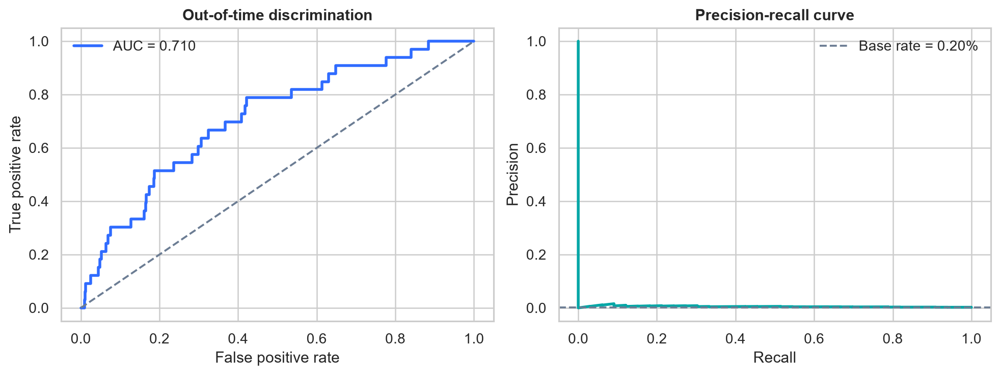
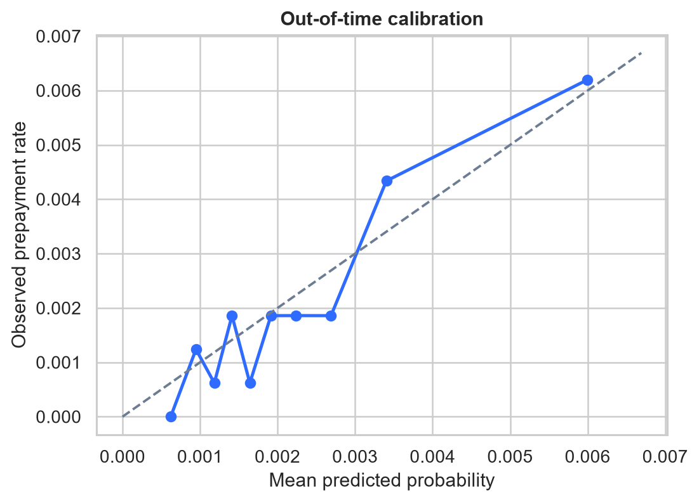
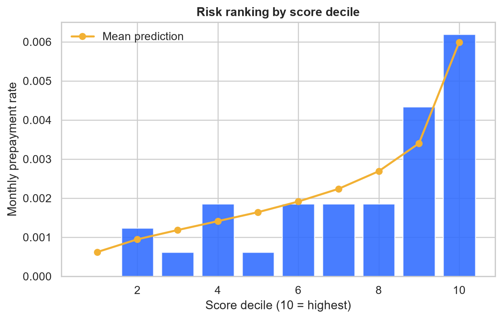
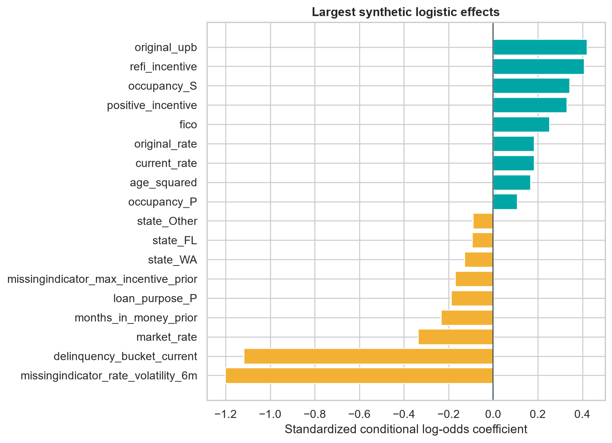

# Mortgage Prepayment Modeling with Public Freddie Mac Data

[](https://www.python.org/)
[](LICENSE)
[](https://www.freddiemac.com/research/datasets/sf-loanlevel-dataset)
[](DATA_LICENSE.md)

An investment-oriented, leakage-aware framework for estimating the monthly
voluntary prepayment hazard of U.S. fixed-rate mortgages. The project separates
a transparent regularized logistic benchmark from a nonlinear gradient-boosting
challenger, validates them through calendar time, and emphasizes probability
calibration—not accuracy alone.

> **Project boundary:** this is an independent project built from public Freddie Mac
> documentation and user-obtained SFLLD files. It contains no proprietary data, code,
> results, or logic.

## Executive summary

Prepayment is an embedded borrower option. When prevailing mortgage rates fall
below a borrower's note rate, refinancing becomes valuable; home sales, equity,
seasoning, transaction costs, underwriting eligibility, and prior missed
opportunities (“burnout”) determine whether that option is exercised. For a
mortgage investor, the resulting negative convexity shortens assets precisely
when reinvestment yields are lower.

This repository estimates a one-month discrete-time hazard:

\[
P(Y_{i,t+1}=1 \mid X_{i,t}),\quad
Y_{i,t+1}=1\;\text{if Zero Balance Code}_{i,t+1}=01.
\]

Freddie Mac defines code `01` as *Prepaid or Matured (Voluntary Payoff)*. A row
is eligible only when the loan is active at `t` and has a contiguous `t+1`
record. The termination row is never exposed to the model.

## What this project demonstrates

- defensible loan-month target engineering with explicit censoring;
- strict no-leakage construction of burnout and payment-history features;
- calendar-time train/validation/test backtesting;
- interpretable logistic and nonlinear gradient-boosting models;
- ROC AUC, PR AUC, log loss, Brier score, calibration, lift, and time stability;
- reproducible command-line execution, unit tests, and a model card;
- data-license-aware publishing: no raw/processed loans or loan-level predictions.

## Repository map

```text
.
├── src/prepayment/
│   ├── data.py          # Release 47 parsing, integrity checks, target
│   ├── features.py      # incentive, seasoning, burnout, credit features
│   ├── modeling.py      # temporal split, two models, metrics
│   ├── reporting.py     # aggregate diagnostics
│   ├── schema.py        # July 2026 Release 47 schemas
│   └── synthetic.py     # deterministic CI/demo generator
├── tests/               # target and temporal-split invariants
├── docs/                # methodology, data dictionary, reproducibility
├── reports/demo/        # committed aggregate synthetic-demo outputs
├── data/                # all loan-level contents ignored by git
├── DATA_LICENSE.md      # data use and redistribution boundary
└── pyproject.toml
```

## Data source and responsible use

The intended empirical source is Freddie Mac's **Single-Family Loan-Level
Dataset (SFLLD)**. Freddie Mac reports that the Standard and Non-Standard data
cover roughly 55 million mortgages originated from 1999 through 2025, with
monthly performance through September 2025 as of the July 2026 publication.
Access requires registration and sign-in to Clarity and is subject to Freddie
Mac's terms.

This repository intentionally does **not** redistribute:

- raw Freddie Mac files, including website format samples;
- cleaned or sampled loan-month records;
- loan identifiers or loan-level model predictions;
- serialized models trained on Freddie Mac data.

The July 2026 Release 47 website sample is useful for checking the new schema,
but its origination and performance loan identifiers do not overlap. It is not a
valid empirical modeling sample. The code fails loudly if those files are paired.
See [data access and license notes](DATA_LICENSE.md).

## Quick start: fully reproducible synthetic demonstration

The synthetic mode tests the complete workflow without restricted data. Its
metrics are software demonstrations—not claims about Freddie Mac loans.

```bash
python -m venv .venv
# Windows: .venv\Scripts\activate
# macOS/Linux: source .venv/bin/activate
python -m pip install -e .
python -m pytest
prepayment-model demo --loans 3000 --seed 42 --output reports/demo
```



<p align="center">
  
  
</p>



Driver signs are conditional associations, not causal effects. In logistic mode,
numeric features are standardized before estimation, so their coefficient sizes
are comparable within the fitted specification; categorical effects are relative
to the encoded reference structure. In nonlinear mode, the report uses
out-of-time permutation AUC loss instead.

The generated [demo results](reports/demo/DEMO_RESULTS.md) are clearly labeled
synthetic and are included so a reviewer can inspect expected outputs before
obtaining SFLLD access.

## Running on locally licensed Freddie Mac files

1. Open the [official SFLLD page](https://www.freddiemac.com/research/datasets/sf-loanlevel-dataset).
2. Register/sign in to Clarity and review the terms yourself.
3. Download matching Release 47 origination and monthly performance files.
4. Place them under `data/raw/` (already gitignored).
5. Create the monthly mortgage-rate file with
   `python scripts/download_fred_mortgage_rate.py`, or supply an auditable
   alternative CSV with `period,market_rate`.
6. Run:

```bash
prepayment-model freddie \
  --origination data/raw/orig_2022Q1.txt \
  --performance data/raw/perf_2022Q1.txt \
  --macro data/raw/market_rates.csv \
  --output reports/freddie
```

Current parsing targets the enhanced Release 47 layout effective July 2026.
Earlier SFLLD releases use a different layout and should be converted explicitly,
not positionally guessed.

## Modeling design

### Target and risk set

At month `t`, the model sees an active loan with positive UPB and no termination
code. It receives a positive response only when the same loan's immediately next
calendar-month record carries code `01`. Noncontiguous records are removed from
the risk set because their next-month outcome is unobserved. This prevents the
common error of labeling right-censored records as negatives.

### Economically motivated features

| Theme | Representative fields | Investment interpretation |
|---|---|---|
| Refinance option | note rate − market rate; positive incentive | Gross economic benefit of refinancing |
| Seasoning | loan age; nonlinear age term | Frictions at low age and burnout at high age |
| Burnout | prior in-the-money months; maximum prior incentive | Revealed nonresponse to prior refinance opportunities |
| Loan economics | UPB; balance factor; term | Closing-cost economics and remaining exposure |
| Credit / collateral | FICO; DTI; LTV/CLTV; estimated LTV | Refinance eligibility and available equity |
| Borrower / property | purpose; occupancy; property type; FTHB | Mobility and segment-specific behavior |
| Performance path | prior delinquent months; modification | Competing distress and workout pathways |
| Geography / channel | state; origination channel | Housing turnover, costs, and borrower acquisition |

Every cumulative feature is shifted so only history through `t-1` enters the row
at `t`. Optional market rates are joined contemporaneously by month.

### Models

1. **Regularized logistic regression** is the governance baseline. It is stable,
   auditable, and directionally interpretable.
2. **Histogram gradient boosting** captures thresholds and interactions, such as
   stronger incentive response among high-FICO, low-LTV, high-balance borrowers.

Both pipelines perform imputation and encoding internally. Candidate selection
uses validation ROC AUC; after selection, the winner is refit on train +
validation and evaluated once on the untouched test interval.

### Validation philosophy

Random loan-month splitting is inappropriate because adjacent records share the
same loan, rate regime, and macro environment. This project uses nonoverlapping
calendar blocks: the earliest 60% of months for training, next 20% for model
selection, and latest 20% for final testing. In a full research program I would
add rolling-origin folds, vintage holdouts, and loan-clustered bootstrap intervals.

### Why accuracy is omitted

Monthly prepayments are imbalanced. A classifier predicting “no prepayment” for
every loan can appear accurate while having no investment value. The core metrics
are:

- ROC AUC for rank ordering;
- PR AUC for minority-event retrieval;
- Brier score and log loss for probability quality;
- calibration by score band and month;
- top-decile lift for concentration;
- ultimately, UPB-weighted SMM/CPR and runoff forecast error.

## Interpreting results responsibly

High AUC alone does not guarantee useful cash-flow forecasts. Mortgage valuation
requires calibrated probabilities under the relevant rate path. Review score
deciles, time stability, vintage, servicer, geography, credit bands, and UPB
weighting. Large errors during a rate shock may be economically more important
than a small average improvement in discrimination.

The synthetic demonstration is designed with known nonlinear relationships, so
its achieved AUC is neither a benchmark nor a target for real SFLLD work. Real
performance depends on horizon, population, vintage, rate environment, leakage
controls, and whether the payoff definition includes scheduled maturity.

## Limitations and next research steps

1. **Competing risks:** estimate separate refinance/sale/maturity/default hazards,
   or use a multinomial/survival framework.
2. **Macro scenarios:** replace a single observed rate with a term-structure-aware
   refinance rate, house-price dynamics, turnover, and unemployment.
3. **Interpretability:** add out-of-time permutation importance, partial dependence,
   ICE, and constrained monotonicity where economics justify it.
4. **Uncertainty:** loan-clustered bootstrap confidence intervals and sensitivity
   to censoring, samples, feature lags, and calendar windows.
5. **Cash-flow translation:** aggregate SMM to CPR, weight by beginning UPB, and
   compare projected versus realized principal runoff.
6. **Production controls:** schema/version contracts, data-vintage manifests,
   drift monitoring, challenger governance, and locked environments.

See the full [methodology note](docs/METHODOLOGY.md) and [model card](docs/MODEL_CARD.md).

## References

- [Freddie Mac SFLLD overview](https://www.freddiemac.com/research/datasets/sf-loanlevel-dataset)
- [Freddie Mac General User Guide](https://www.freddiemac.com/fmac-resources/research/pdf/user_guide.pdf)
- [Freddie Mac Terms and Conditions](https://capitalmarkets.freddiemac.com/crt/docs/pdfs/fre_terms_conditions_sflld.pdf)
- [Freddie Mac Frequently Asked Questions](https://www.freddiemac.com/fmac-resources/research/pdf/faq.pdf)
- [FRED MORTGAGE30US series](https://fred.stlouisfed.org/series/MORTGAGE30US)

## Disclaimer

For research and educational use only. Not investment advice, a valuation model,
or an official Freddie Mac publication. Freddie Mac does not endorse this work.
The author makes no representation that the model is suitable for trading, risk
limits, accounting, capital, or borrower decisions.
